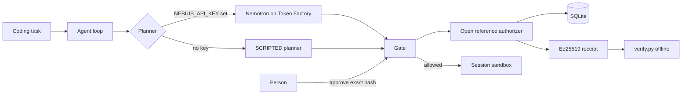

# AI4 Gate, Nebius hackathon edition

Approve the exact action, or it does not run.

This is a prototype for the Nebius x NVIDIA Global AI Hackathon, Coding and Agentic Engineering track. A coding agent proposes tool calls. An authorization gate checks each call before anything runs. Safe calls run inside a disposable sandbox. Risky calls wait for a person. Every execution-time decision, allowed or refused, and every outright policy denial at proposal time produces an Ed25519 signed receipt that a separate program can check offline. A pending proposal that never executes and is not denied by policy does not generate a receipt.

Owner: The Singulant L.L.C-FZ.

License: Apache-2.0. See [LICENSE](LICENSE) and [NOTICE](NOTICE).

This directory is self-contained. It does not import a private package. Public repository: https://github.com/TheSingulant/ai4-gate-nebius

## Quick start (offline, no API key)

Requires Python 3.11+ and git.

```bash
# Run these from this directory.
# This file is at the repository root.
python -m venv .venv && . .venv/bin/activate
pip install -e ".[dev]"
python -m pytest -v
python -m gate_demo.demo --out demo-output
```

`python -m gate_demo.demo` always uses the SCRIPTED planner, even if a key is set in the environment. It prints `DEMO OK`. The label on every receipt is `SCRIPTED` and the model id is `scripted-offline`. That planner is not NVIDIA Nemotron.

Check a receipt yourself (the demo prints the public key):

```bash
python verify.py demo-output/receipts/01-allowed-policy_allow.json --trusted-key <hex from demo-output/keys.json>
python verify.py demo-output/tampered-receipt.json --trusted-key <same hex>
```

The second command is invalid and exits 1.

Web UI:

```bash
python -m gate_demo.server
```

Open http://127.0.0.1:8000. The server defaults to `GATE_MODE=guided`: three preset scenarios, and a free-text task is refused. Set `GATE_MODE=open` on a local machine if you need to type a task. Do not use open mode on a public host. With no key, the badge says `SCRIPTED`. Approve or deny the actions that stop for a person. **Verify signature** stays on the page after the two second refresh. **Replay last allowed action** and **Submit altered action** show the rejection.

## Tests

```bash
python -m pytest -v
```

The `live` marker calls Nebius. It is skipped unless `NEBIUS_API_KEY` is set. To run it on a machine that has the key:

```bash
python -m pytest -m live -v
```

That test makes one real chat completion. It does not print the key.

## Live Nemotron run

A redacted summary of seven real runs is in [evidence/live-e2e-redacted.json](evidence/live-e2e-redacted.json). Response ids, prompts, and model text were removed. See [evidence/README.md](evidence/README.md).

On a machine that has the key, from this directory, with the package installed:

```bash
export NEBIUS_API_KEY="..."          # do not commit this, and do not echo it
# optional overrides:
# export NEBIUS_BASE_URL="https://api.tokenfactory.nebius.com/v1/"
# export NEBIUS_MODEL="nvidia/Nemotron-3.5-Super-VL"
make live-e2e
```

The same command without make:

```bash
python -m gate_demo.live_e2e --out evidence/live-e2e.json
```

What it does:

1. Refuses to start, exit code 2, if `NEBIUS_API_KEY` is missing. It prints `BLOCKED` and does not write evidence.
2. Forces `PLANNER=nebius` and calls Nebius Token Factory with the OpenAI-compatible client and function calling.
3. Runs the coding task through the gate. An unattended approver accepts only `write_file` and `run_python` under `scripts/*.py`, and `git_push` to `origin/main`. The gate still binds each approval to the SHA-256 of the exact action. Other risky calls are declined. Policy denials never run.
4. Replays one allowed action and submits one altered action.
5. Verifies every receipt with the offline verifier.
6. Writes `evidence/live-e2e.json`.

The file contains request ids, model names, token usage, timestamps, gate decisions, receipt hashes, and verifier results. It does not contain the API key. If redaction cannot remove the key, the command refuses to write the file.

Exit codes: `0` the run finished and real receipts verified, `1` the call failed or a real receipt did not verify, `2` no key.

After you have read the file and confirmed the key is absent, you may keep a further redacted summary. Do not commit `evidence/live-e2e.json` or `evidence/models/`. Those paths are gitignored.

## Where Nebius Token Factory and NVIDIA Nemotron are used

Only `NebiusPlanner` in `src/gate_demo/planner.py` talks to Nebius. It is used when `PLANNER=nebius`, or when `PLANNER=auto` (the default) and `NEBIUS_API_KEY` is set. The key is read from that environment variable and is not written into receipts, logs, or API responses.

| Setting | Default | Override |
|---|---|---|
| Base URL | `https://api.tokenfactory.nebius.com/v1/` | `NEBIUS_BASE_URL` |
| Model | `nvidia/Nemotron-3.5-Super-VL` | `NEBIUS_MODEL` |

Sources checked on October 28, 2026:

- OpenAI-compatible base URL: [Token Factory introduction](https://docs.tokenfactory.nebius.com/api-reference/introduction) and [function calling](https://docs.tokenfactory.nebius.com/ai-models-inference/function-calling). The same host without a trailing slash is the same endpoint.
- Model id and `function_calling` in the public catalog: [models_info](https://tokenfactory.nebius.com/api/public/models_info).
- Catalog price for this model id on that date: input 0.30 USD per million tokens, cached input 0.06 USD, output 0.90 USD. Region listed: us-north1. The default base URL is the region-neutral host above.
- `nvidia/nemotron-3-super-120b-a12b` leaves Token Factory Serverless on November 9, 2026. Nebius names `nvidia/Nemotron-3.5-Super-VL` as the replacement. See [Model Deprecations: November 2026](https://docs.tokenfactory.nebius.com/model-deprecations-november-2026).
- The same day, seven gated live runs were recorded in `evidence/live-e2e-redacted.json`. One used `nvidia/nemotron-3-super-120b-a12b` (10 actions, 20123 prompt tokens, 1379 completion tokens, 15 seconds between the recorded timestamps). Three used `nvidia/Nemotron-3.5-Super-VL` and each proposed the same 9 actions, with prompt tokens 16921, 16925, and 16925, completion tokens 1131, 1134, and 1171, and timestamp spans of 10, 10, and 12 seconds. Three used `nvidia/Nemotron-3_5-Lightning` and varied (10, 14, and 13 actions; prompt tokens 22161, 32961, and 29930). One Lightning decision was an unknown tool `mkdir` (`unknown tool: 'mkdir'`), which the gate did not run. Every listed receipt verified. Every replay was `ALREADY_CONSUMED`. Every tamper was `ACTION_MISMATCH`.
- The legacy host `https://api.studio.nebius.com/v1` is not the default.

Each turn sends the tool schemas (`read_file`, `write_file`, `run_python`, `run_tests`, `git_commit`, `git_push`, `send_message`) and takes the first tool call. That call goes through the gate. The model sees the gate result as the tool message. There is no shell tool.

Receipts and the UI show `NEMOTRON-LIVE` plus the model id for actions that planner proposed. The scripted planner is labeled `SCRIPTED`. A direct API propose is labeled `OPERATOR`. The UI badge is the configured planner. It does not claim a live call happened until an inference record exists.

## Architecture



| Path | Role |
|---|---|
| `src/gate_demo/planner.py` | Nemotron client and the scripted planner |
| `src/gate_demo/agent.py` | One tool call at a time, through the gate |
| `src/gate_demo/gate.py` | Propose, approve, execute. Verifies the receipt before a tool runs |
| `src/gate_demo/authorizers/reference.py` | Open reference authorizer |
| `src/gate_demo/workspace.py` | Local git remotes, simulated outbox, resource limits |
| `src/gate_demo/api.py` and `static/index.html` | Hosted demo UI |
| `src/gate_verify/verify.py` and `verify.py` | Independent verifier. It does not import the gate |
| `src/gate_demo/live_e2e.py` | Live end to end command |

### What the gate guarantees in this prototype

- The action that runs is the action that was approved. The approval is a signature over the SHA-256 of the canonical action, the proposal id, and an expiry.
- An approval is single use. Replaying it returns `ALREADY_CONSUMED`.
- Changing any argument changes the hash. Execution returns `ACTION_MISMATCH` and does not run the tool.
- Policy can allow, require a person, or deny. A denial produces a signed receipt and does not run the tool.
- Every receipt includes `planner` and `model_id`, and the signature covers them.

### What this reference authorizer is not

Production AI4 infrastructure operated by The Singulant is a different system. This prototype does not include that service, a client for it, its policies, or its operational setup. If you set `AUTHORIZER` to anything other than `reference`, the process refuses to start.

The reference engine runs in this process. It holds the demo approver key itself, so the person is whoever can call the approve route for that session. It uses SQLite, one process, and the machine clock. There is no key rotation and no trusted timestamp. A receipt proves the signing key's decision about an exact action. It does not prove the tool succeeded, and it does not prove who the human was.

The sandbox is a limit on a local process, not a virtual machine. Git remotes are bare repositories on local disk (`protocol.allow=never`). `send_message` appends to a local outbox and does not open a network connection. `run_python` and `run_tests` use a stripped environment, a wall clock timeout, CPU and address-space limits, and an output cap. Do not point this demo at a workspace you cannot throw away.

## Hosted demo

Build and run locally:

```bash
docker build -t ai4-gate-hackathon .
docker run --rm -p 8000:8000 --env-file .env ai4-gate-hackathon
```

Leave `NEBIUS_API_KEY` empty in `.env` for a scripted demo with no inference spend. To enable Nemotron, put the key only in the host environment or a secret store, not in the image. `.dockerignore` excludes `.env` and raw evidence JSON.

For a private preview behind Caddy, with the budget database on a volume, see [docs/DEPLOY.md](docs/DEPLOY.md). This package does not deploy itself.

The container listens on port 8000. Sessions last `SESSION_TTL_SECONDS` (default 1800) and the reaper deletes the workspace. Rate limits are per IP and global, separate for reads and for state-changing calls. `GATE_DAILY_REQUEST_BUDGET` and `GATE_DAILY_TOKEN_BUDGET` cap live Nebius calls. `GATE_DAILY_AGENT_RUNS` also caps scripted runs so a public process cannot be looped for CPU. Set `GATE_BUDGET_DB` to a file (the Dockerfile uses `/app/data/budget.sqlite3`) so a restart does not clear the cap. Deleting that file is the operator reset.

Behind a proxy, set `GATE_TRUST_PROXY=1` only if the proxy overwrites `X-Forwarded-For`. Otherwise every user shares the proxy IP.

A small single container is enough: a VM you already have, or a host such as Render. This package does not create a host account and does not deploy itself.

### Cost, stated as limits rather than a measured bill

Scripted mode makes no Token Factory call. Judges can run the Docker image or `python -m gate_demo.server` with no key through December 15, 2026 at zero inference cost.

Live mode is metered by Nebius at the catalog prices above. The default cap is 40 requests and 200,000 tokens per UTC day. If that entire token cap were output tokens, the catalog price is 0.18 USD per day. If it were input tokens, it is 0.06 USD per day. From October 28 through December 15, 2026 is 48 days, so the ceiling if the cap is hit every day is about 2.88 to 8.64 USD of inference, plus whatever the host charges. A single coding session is smaller than the daily cap. The seven recorded runs in `evidence/live-e2e-redacted.json` used between 16921 and 32961 prompt tokens each. This paragraph is arithmetic on the published price and the configured cap. It is not a measured invoice.

The default model, `nvidia/Nemotron-3.5-Super-VL`, is not on the November 9, 2026 serverless removal list. The previous default, `nvidia/nemotron-3-super-120b-a12b`, is. Hosting cost is separate and was not priced here.

## Receipt format

See [RECEIPT_SPEC.md](RECEIPT_SPEC.md). This edition adds signed `planner` and `model_id` fields to `gate-receipt/1`.

## Development during the hackathon

See [HACKATHON.md](HACKATHON.md). Submission drafts, not submitted, are under [submission/](submission/).
